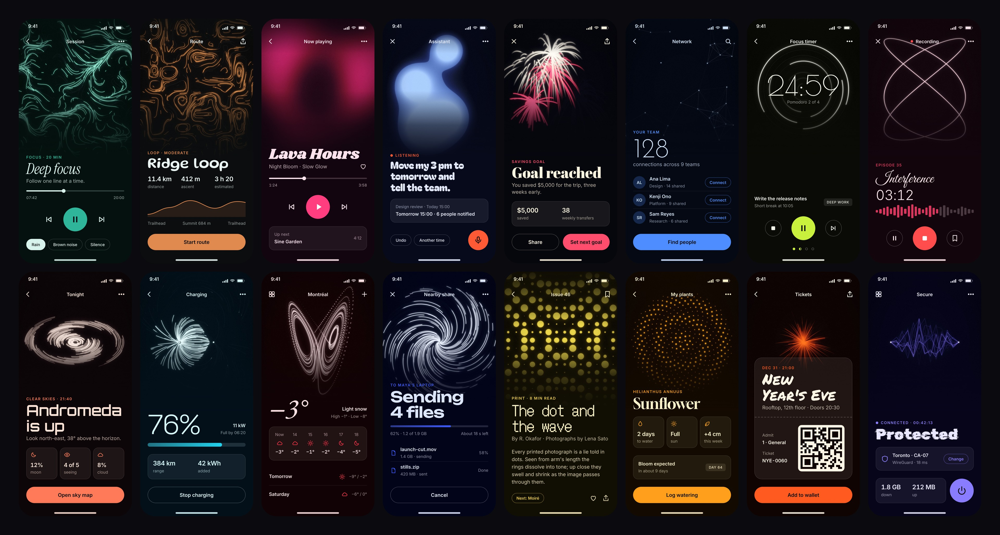

# Uno.Effects media

Captured from the library at `681211d`, gallery Release build, Skia Desktop on Linux (Xvfb).

| Folder | What |
|---|---|
| `art/` | 16 finished art pieces + `00-library-poster.jpg`. Captioned with the catalog number and description. |
| `art/clean/` | Same 16 pieces without captions, for backgrounds and crops. |
| `posters/` | 32 posters (1600×2000) in two series, each in its own palette. See [Posters](#posters). |
| `posters/video/` | The animated versions: 1080×1350, 30 fps, H.264, 10 s seamless loops. |
| `mockups/` | The 16 series-1 effects as the hero of an app screen, 1080×2340, still and looping (`mockups/video/`). See [App mockups](#app-mockups). |
| `screenshots/` | Real gallery UI at 1600×1000: board, filtered board, detail pages, light surface, SKSL tab, diagnostics. |
| `recording/` | `gallery-walkthrough.mp4` — 45 s, 1600×1000, 30 fps, real time. |
| `tweet.md` | Launch tweet drafts and which images to attach. |
| `_source/` | Shot lists and scripts to regenerate the art, poster and recording. |

## How the art was made

The effects were driven by their own `ParticleEffect.Render` at a fixed 1/60 s timestep,
the same loop the render tests use, but at 1280–2560 px instead of 256. Files named
`*-longexp` lighten-blend the last N frames into one image (a long exposure); `*-paper`
uses a light surface with dark ink and darken-blends. No pixels are painted by hand.

Palettes are built around the gallery's amber accent (`#D6A068`) and warm neutrals close to
its surfaces. The only knobs moved off their defaults are Plasma (`Cells` 96) and Phyllotaxis
(`Count` 400, `Size` 1.6), as listed in `shots.json`. The finishing pass (`finish.py`) adds
bloom on bright pixels only, a vignette, film grain and the caption.

## Regenerate

Needs the .NET 10 SDK and Python 3 with Pillow and NumPy. Fonts: Inter and DejaVu Sans Mono.
If they are not in a standard font folder, set `UNO_FX_FONTS` to the folder that has them.

From the repo root:

```
git apply media/_source/App.xaml.cs.capture.patch
cp media/_source/ArtRenderer.cs samples/Gallery/Uno.Effects.Gallery/
dotnet build samples/Gallery/Uno.Effects.Gallery -f net10.0-desktop -c Release
```

The patch adds `--art <spec.json> <outDir>` and `--window WxH` to the gallery. It is for capture
only: revert it and delete the copied `ArtRenderer.cs` before committing.

Then, with `G` set to `samples/Gallery/Uno.Effects.Gallery/bin/Release/net10.0-desktop/Uno.Effects.Gallery`
(`.exe` on Windows, called as `& $G` in PowerShell; prefix `xvfb-run -a` on a Linux box with no display):

```
$G --art media/_source/shots.json raw/
python media/_source/finish.py raw/ out/
python media/_source/poster.py out/clean out/00-library-poster.jpg
```

`out/` then mirrors `art/`. The full-size renders take a few minutes; for a quick check, set
`"scale": 1` on every shot.

| File | Role |
|---|---|
| `shots.json` | The 16 published shots and their final parameters. |
| `candidates.json` | Two shots that were rendered and not kept (bokeh over nebula, sphere). Kept so they can be revisited. |
| `ArtRenderer.cs` | Capture-only renderer: fixed timestep, any size, optional long exposure. |
| `finish.py` | Bloom, vignette, grain, scrim and caption. Captions are the catalog's own number, name and description. |
| `poster.py` | The 4×4 library poster from `art/clean`. |
| `drive.py` | Scripted pointer for the recording. |

### Recording

Linux only (`xdotool`). Run the gallery with `--window 1600x1000` with its client area at the
top-left of the display, then:

```
ffmpeg -f x11grab -video_size 1600x1000 -framerate 30 -i $DISPLAY -c:v libx264 -pix_fmt yuv420p -crf 18 gallery-walkthrough.mp4 &
python drive.py
```

`drive.py` uses fixed screen coordinates for that window size. The ffmpeg line reproduces the
published file's format (H.264, 1600×1000, 30 fps); the exact flags of the original capture
were not recorded.

## Posters

`posters/` holds 32 posters (4:5, 1600×2000) in two series, one effect and one palette each, with an
animated version of every one in `posters/video/` (1080×1350, 30 fps, H.264, 10 s loops).

| Series | Shot list | Pieces |
|---|---|---|
| 1 | `_source/posters.json` | The 16 art pieces. |
| 2 | `_source/posters-2.json` | 16 more effects. |

Every poster is dark, and each title face is chosen to match how its effect moves: DotGothic16 for
Halftone, Rubik Glitch for Arcs, Shrikhand for Plasma, Silkscreen for Cascade, Monoton for Trail.

Two layouts:

- **Plate** (all 32): the art fills the sheet. Every element has one job:
  - top left, identity: library and catalog number;
  - top right, the exposure, with numerals 60 px tall in every face; single-frame pieces read `1/60 s`;
  - left, the title column in the effect's own face;
  - bottom, the caption (21 px x-height in every face, 84% ink), then the run as a bar with its axis
    in seconds. The lit part is the exposure; a single frame is a square at the end.

  The accent means time: the exposure label and the lit bar share it, and so does the title's full stop.
  Margins are 80 px on all four sides, measured to cap tops and baselines with `text-box-trim`.
- **Specimen** (unused now; Lissajous, Halftone and Metaballs had it before they moved to dark plates):
  the art sits in a plate on a sheet beside the effect's own knobs, each default marked in its range.

Each shot's `poster` block holds the title, caption, colours, title font (`package`, `weight`, `style`,
`tracking`, optional `caption: "mono"`) and placement (`shift`, `zoom`, `scrim` behind the title). The catalog number comes from
`Catalog.json`. The type layer is HTML rendered by Playwright (`posters_overlay.js`); the art is the
effect's output with the same finishing as `art/`. Fonts are SIL OFL faces from Fontsource, fetched by
`posters.py` from npm into `_source/.fonts/` (gitignored) on first use; small type is IBM Plex Mono.
Needs Node with Playwright and a Chromium.

With the capture patch applied and the gallery built as above, for either shot list:

```
$G --art media/_source/posters-2.json raw-posters/
python media/_source/posters.py stills media/_source/posters-2.json raw-posters/ media/posters/
```

Animated versions are 10 s loops. An exposure piece becomes a moving long exposure: the renderer's
`persistence` fades each frame towards the surface over the exposure's length while the effect keeps
running, so the trails match the still. The bar shows that window sliding along the loop. Single-frame
pieces play live under a thin playhead. Each sequence runs 11 s and its last second is crossfaded into
the first, so the end leads straight back into the start.

```
python media/_source/posters_video_spec.py media/_source/posters-2.json posters-video.json
$G --art posters-video.json seq/
python media/_source/posters.py videos media/_source/posters-2.json seq/ media/posters/video/
```

## App mockups



`mockups/` shows each series-1 effect where it would ship: as the hero of a phone screen (360×780 pt at
3×, so 1080×2340), fading into the app's surface under real controls. Each screen pairs an app with the
effect's mood: a meditation session (Flow field), a hiking route (Curl noise), a music player (Plasma), a
voice assistant (Metaballs), a savings goal (Fireworks), a team network (Constellation), a focus timer
(Orbits), a podcast recorder (Lissajous), stargazing (Galaxy), EV charging (Dipole), weather (Attractor,
since Lorenz found chaos in a weather model), a file transfer (Vortex), a magazine (Halftone), plant care
(Phyllotaxis), a New Year's Eve ticket (Sparkler) and a VPN (Arcs). Headings use the effect's poster
face, text is Inter, colours are its palette.

The hero is 1080×1350, the loop sequences' own size, so `mockups.py` reuses the posters' inputs and
finishing as they are:

```
python media/_source/mockups.py stills raw-posters/ media/mockups/
python media/_source/mockups.py videos seq/ media/mockups/video/
python media/_source/mockups.py overview media/mockups/
```

`overview` tiles the finished screens into `00-overview.jpg` and `video/00-overview.mp4`
(3840×2056, all 16 loops running together; they share the 300-frame loop, so the overview loops too).

The screens share one system: content anchored 42 pt above the bottom on 24 pt edges, a 4 pt grid
(8 / 12 / 16 / 24 / 32 between things), headings in three steps (88 for hero numbers, 48 for titles,
32 for sentences), Inter at 16 / 15 / 13 / 12, ink at 100 / 84 / 60 %, icons at 20 / 24 / 28 / 32.
Actions are outlined in the accent; status tags are quiet filled labels; at most one filled primary action per screen.

## Caveat on numbers

The Metaballs detail screenshot's footer shows ~280 ms per frame. That is SKSL on the CPU
raster backend in a 4-core cloud VM, not a representative figure. The Constellation
diagnostics shot (57 fps, 3.6 ms) is typical for the particle effects.
